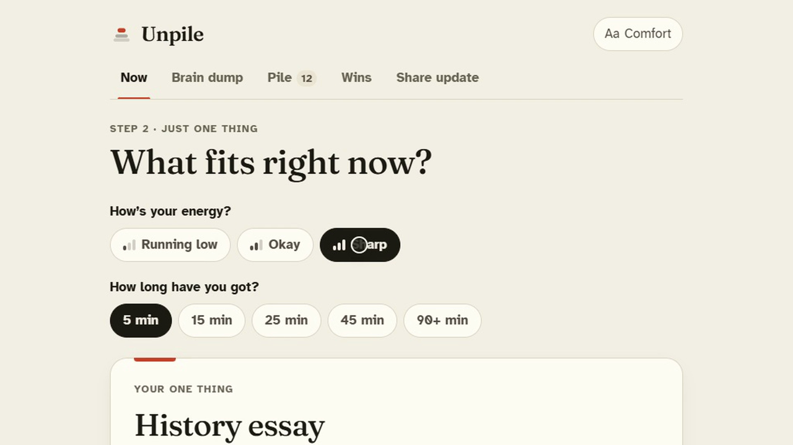
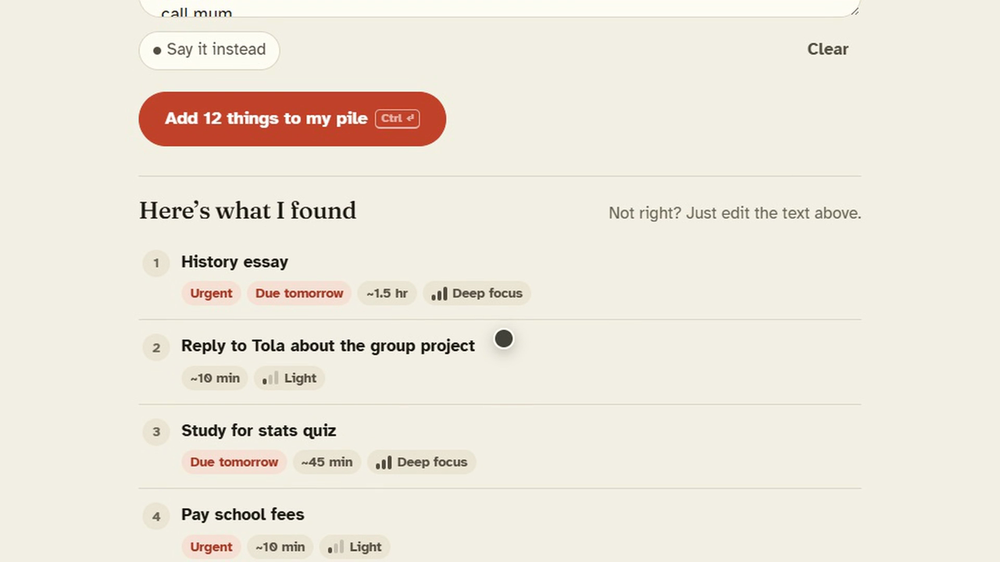
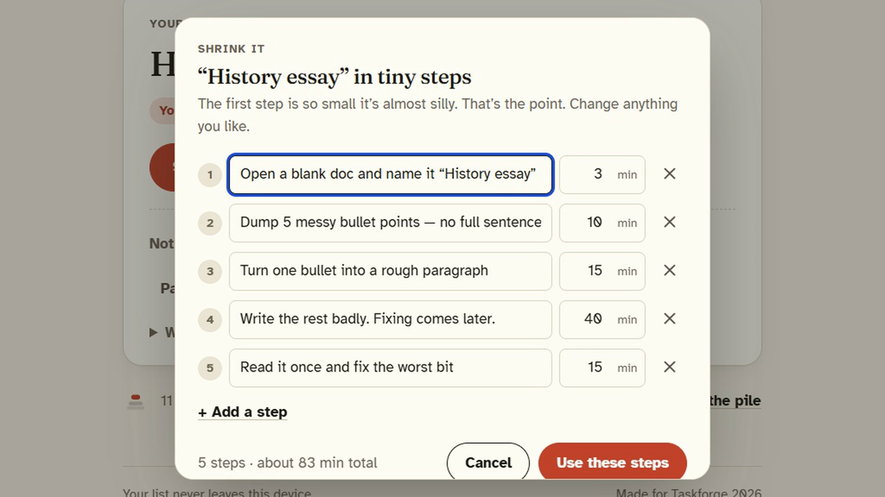
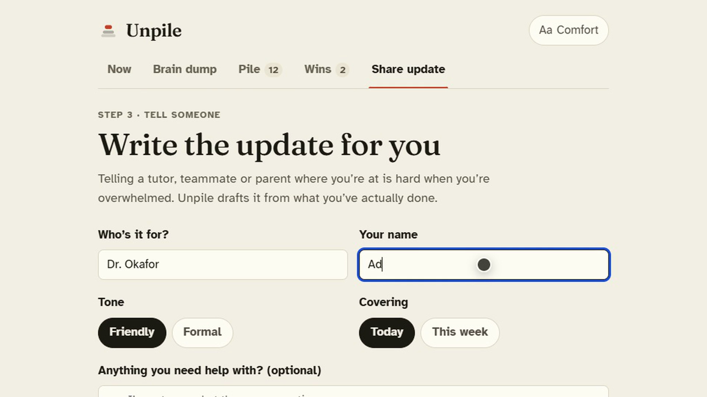

<p align="center">
  
</p>

<p align="center"><strong>Turn an overwhelming to-do list into one calm next step.</strong></p>

<p align="center">
  <a href="https://github.com/opeblow/unpile/actions/workflows/deploy.yml"></a>
  <a href="LICENSE"></a>
  
  
  
  
  
  
  
  <a href="CONTRIBUTING.md"></a>
</p>

<p align="center">
  <a href="https://opeblow.github.io/unpile/"><b>Live demo</b></a> ·
  <a href="#"><b>Launch film (2:53)</b></a> ·
  <a href="docs/SYSTEM_DESIGN.md">System design</a> ·
  <a href="setup.md">Setup</a> ·
  <a href="CONTRIBUTING.md">Contributing</a>
</p>

---

<p align="center"></p>

## The problem

You open your to-do list. Essay, school fees, a message you keep avoiding, laundry, call mum. Twelve things, all shouting. You do none of them.

That’s **task paralysis**, and a longer, tidier list makes it worse. Unpile does the opposite: it **hides the pile and shows you one thing**.

## How it works

| 1 · Empty your head | 2 · Get one thing | 3 · Tell someone |
| --- | --- | --- |
| Type or say everything, messy. Unpile finds tasks, due dates, urgency, time and focus needed. | Say how you feel and how long you have. Get **one** task and the reason why. Too big? Shrink it to a 3‑minute first step. | Behind? Unpile drafts a friendly or formal update for your tutor, team or family from what you actually did. |
|  |  |  |

## Features

- 🧠 **Brain dump** (type or speak) — understands “friday”, “tmrw”, “24th oct”, “asap”, “!!”, “40 min”, `#tags`, and ignores “ugh ok, so much to do”
- 🎯 **One thing** — energy + time check-in, one suggestion, plain-language reasons, “show me another” that never nags
- ✂️ **Shrink it** — big tasks become 3–5 editable steps; the first is always ≤5 minutes
- ⏱️ **Focus mode** — calm full-screen timer, gentle chime, and a “Not finished — that’s okay” button
- 🅿️ **Park & undo** — every destructive action can be undone
- 🌱 **Wins** — what you finished, no streaks to break
- ✉️ **Share update** — friendly or formal progress message, copy / share / email
- ♿ **Comfort** — Atkinson Hyperlegible or Lexend, text up to 130%, high contrast, calm motion, keyboard shortcuts, screen-reader support
- 🔒 **Private & offline** — no account, no server, no tracking; installable PWA

## Quick start

```bash
npm install
npm run dev          # http://localhost:5173
```

Click **“Try a sample list”** on the landing page. Full guide: [setup.md](setup.md).

```bash
npm test             # 21 unit tests (Vitest)
npm run test:e2e     # 21 end-to-end runs on desktop + mobile, incl. axe accessibility (Playwright)
npm run build        # strict type-check + production build
```

## Project structure

```text
unpile/
├── .github/workflows/deploy.yml   # CI: unit + e2e tests → build → GitHub Pages
├── docs/
│   ├── SYSTEM_DESIGN.md           # architecture, algorithms, data model, trade-offs
│   └── screenshots/
├── e2e/
│   └── unpile.spec.ts             # Playwright journeys + axe accessibility checks
├── public/                        # icon.svg · logo.svg · manifest · offline service worker
├── src/
│   ├── lib/                       # pure, tested logic (no React)
│   │   ├── parse.ts               # brain dump → tasks
│   │   ├── pick.ts                # one task + reasons
│   │   ├── shrink.ts              # task → tiny steps
│   │   ├── store.ts               # reducer, persistence, sanitize
│   │   ├── share.ts               # progress message
│   │   ├── dates.ts · types.ts · sample.ts
│   │   └── lib.test.ts
│   ├── components/                # Landing · Dump · Now · Focus · ShrinkDialog
│   │                              # Pile · Done · Share · SettingsDialog · ui
│   ├── App.tsx                    # routing, toasts + undo, dialogs
│   ├── main.tsx
│   └── styles.css                 # design tokens + all styles
├── AGENTS.md · CONTRIBUTING.md · CODE_OF_CONDUCT.md · SECURITY.md · LICENSE
├── plan.md · setup.md · DEVPOST.md
└── package.json · vite.config.ts · playwright.config.ts · tsconfig.json
```

## Design principles

- **One decision per screen.** The pile is hidden unless you ask for it.
- **Explain, don’t nag.** Every suggestion says why; skipping is respected.
- **No guilt.** No streaks, no red alarms, parking is valid.
- **Accessible by default**, not as a setting.
- **Rules over AI.** Instant, free, private, offline and explainable. See [system design](docs/SYSTEM_DESIGN.md).

## Contributing

Contributions are welcome. Read [CONTRIBUTING.md](CONTRIBUTING.md) and our [Code of Conduct](CODE_OF_CONDUCT.md). Security issues: see [SECURITY.md](SECURITY.md).

## License

[MIT](LICENSE) © 2026 Unpile contributors. Built for [Taskforge 2026](https://taskforge.devpost.com).
