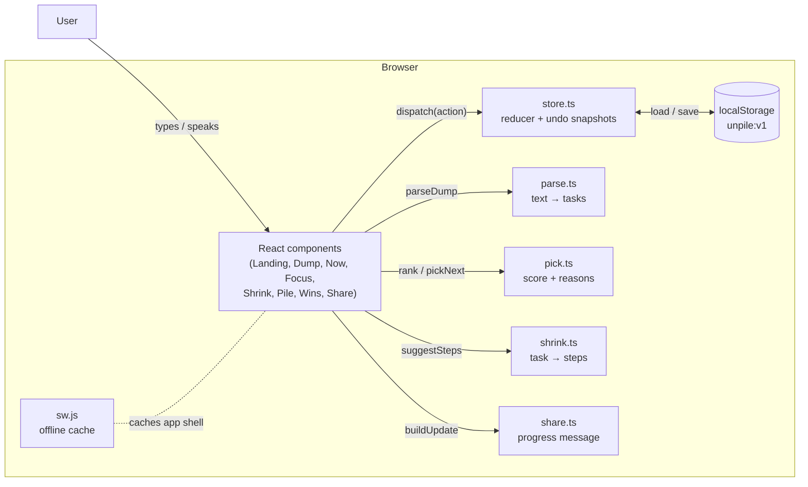

# System design

Unpile is a client-only Progressive Web App. Everything — parsing, choosing, shrinking, storing — happens in the browser. This document explains the parts and why they were built this way.

## Goals and constraints

| Goal | Decision |
| --- | --- |
| Works for an overwhelmed person in seconds | No sign-up, instant on-device logic, one screen = one decision |
| Private by default | No backend, no analytics, `localStorage` only |
| Works on bad connections | Static build + service worker, ~64 kB gzipped JS |
| Trustworthy suggestions | Deterministic rules that return human-readable reasons |
| Accessible | Semantic HTML, real form controls, WCAG 2 AA checked by axe in CI |

## Architecture



There is no network edge after the first load. The only optional external capability is the browser’s Web Speech API for voice input.

## Data model

```ts
Task {
  id, text, raw,                // clean title + what the person typed
  due?: 'yyyy-mm-dd', urgent?,  // local date, no timezones
  minutes, energy: low|medium|high, tags[],
  status: open | done | parked | split,
  parentId?, order,             // steps created by "shrink"
  createdAt, doneAt?, skips, focusMs
}
AppState { version: 1, tasks[], settings, session: { energy, minutes } }
```

**Split tasks.** Shrinking turns a task into a container (`status: 'split'`) and creates ordered child steps. Only the first open step is actionable, so the person only ever sees one step. When every step is done, the parent is marked done automatically. Parking a step parks the parent, so the steps come back together.

## Core algorithms

### 1. Parsing a brain dump (`parse.ts`)

1. **Split** on new lines, `;`, bullets, sentence ends and connectors (“also”, “and then”). Short comma lists (`laundry, dishes, bins`) become separate tasks. Ticked checkboxes are skipped. Filler-only lines (“ugh ok”, “so much to do”) are dropped.
2. **Extract** in order: `#tags` → urgency (`asap`, `urgent`, `!!`) → duration (`40 min`, `2h`, `half an hour`) → due date.
3. **Dates**, relative to an injected `now`: ISO, today/tonight, tomorrow/tmrw, day after tomorrow, in N days/weeks, next week, weekend, end of week, full weekday names, short names only with a preposition (`by fri`, so “sat exam” isn’t a date), and `24th oct` / `Nov 3` with year roll-over.
4. **Clean** filler prefixes (“I need to”, “don’t forget to”) and capitalise.
5. **Estimate** minutes and energy from the leading verb (email → 10 min/light, write → 45 min/deep), bumped to 90 min for big nouns (essay, project, application) unless the verb is light (“email tutor about essay” stays small).

### 2. Picking one thing (`pick.ts`)

For each actionable task, a score is the sum of:

| Signal | Effect |
| --- | --- |
| Urgent | +45 |
| Due: overdue / today / tomorrow / ≤3 days / ≤7 days | +60 / +50 / +35 / +20 / +8 |
| Fits the time available | +20, otherwise a penalty scaled by how much it overruns |
| Energy needed vs energy available | +15 if it fits, −25 per level above |
| Low energy and ≤10 min | +10 (small wins) |
| High energy and deep task | +10 |
| Next step of a split task | +12 (momentum) |
| Each “show me another” | −8 (no nagging) |
| Age | up to +7 |

The highest score wins. Every signal that fires adds a plain sentence to `reasons`, which the UI shows as chips. The session also keeps a “passed” list so “show me another” walks through options before repeating.

### 3. Shrinking (`shrink.ts`)

A recipe table of regexes → 3–5 steps `[text, minutes, energy]`. The recipe is chosen by the first two words first, then the whole text, so the leading verb wins. The first step is always ≤5 minutes and physical. `{t}` is replaced with the task subject (“Write my history essay” → “history essay”). The person can edit everything before saving.

### 4. Progress message (`share.ts`)

Groups tasks into Completed (in the time window), In progress (split tasks with “n of m steps”), Next (top 3 by rank) and On hold (parked), then renders friendly or formal wording with optional recipient, name and help request.

## State and persistence

- `useReducer` with a pure `reducer(state, action, now)`; every change is an action (`add`, `done`, `split`, `park`, …).
- State is saved to `localStorage` after every change. `sanitize()` fills defaults so old or hand-edited data can’t crash the app; it is also used for backup imports.
- **Undo:** destructive actions store the previous state in the toast; Undo dispatches `replace`.
- The brain-dump draft is saved separately so nothing typed is lost.

## Accessibility design

- Segmented pills are real radio groups; switches are checkboxes with `role="switch"`; dialogs use native `<dialog>` with `showModal()` (focus trap and Esc for free).
- Focus moves to the page heading on navigation; the focus timer announces “one minute left” and “time’s up” through an assertive live region.
- Comfort settings write `data-*` attributes and a `--scale` variable on `<html>`; CSS reacts, so no re-render is needed.
- Atkinson Hyperlegible (default) and Lexend are bundled through Fontsource.

## Testing

| Layer | Tool | What it covers |
| --- | --- | --- |
| Unit | Vitest (21 tests) | splitting, dates, parsing the sample, picker choices, shrink recipes, split/park/done lifecycle, share message, sanitize |
| End-to-end | Playwright, desktop + Pixel 7 | landing → dump → now → shrink → focus → wins → share, park/undo, keyboard shortcuts, persistence after reload, settings, no horizontal overflow |
| Accessibility | axe-core in Playwright | WCAG 2 A/AA, zero serious or critical violations on every screen |

E2E tests freeze the clock with `page.clock.setFixedTime` so due-date logic is deterministic.

## Deployment

`vite build` with `base: './'` produces a relative-path static bundle. GitHub Actions runs unit + e2e tests, builds and deploys to GitHub Pages. Any static host works.

## Trade-offs and future work

- **Rules over AI:** instant, free, private, offline and explainable, but English-only and sometimes wrong. Everything is editable. An optional, opt-in on-device model could improve parsing later.
- **localStorage over sync:** zero setup and private, but one device. An optional encrypted sync (e.g. user-held key) is the natural next step.
- **Planned:** more languages for date words, recurring tasks, gentle reminders.
